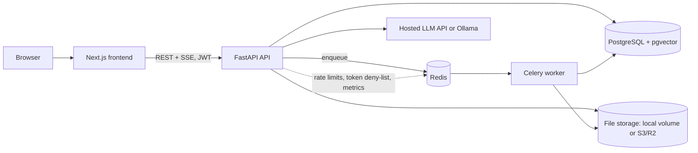
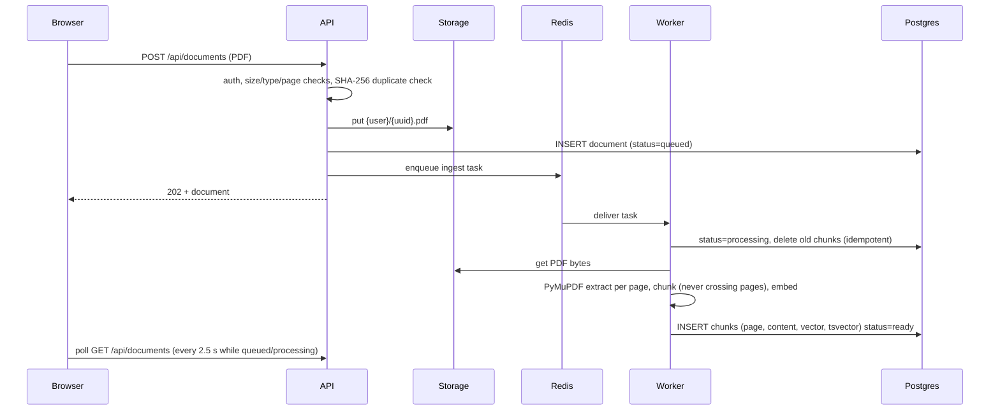
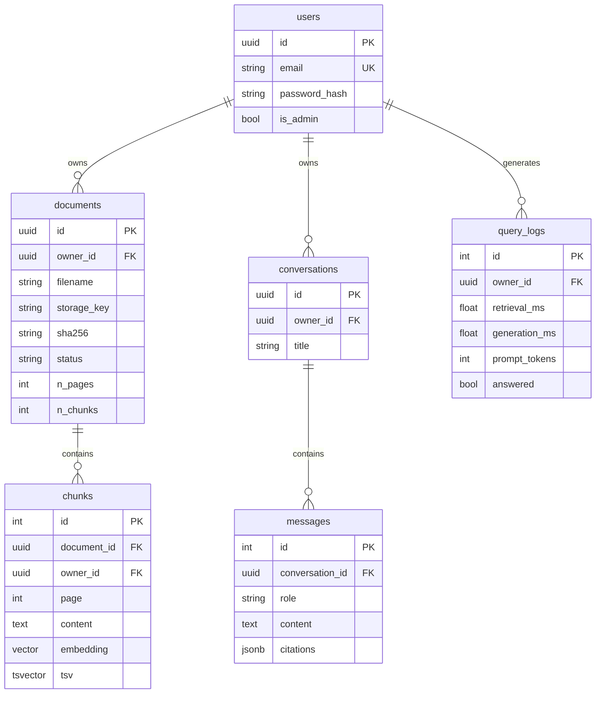

# Architecture

## Components



## Workflow 1: document ingestion



Failure handling: a *permanent* problem (scanned PDF with no text, too many pages, corrupt file) marks the
document `failed` with a readable message and is **not** retried. A *transient* problem (database, storage,
model download) marks it failed and re-raises so Celery retries with backoff (max 2). A task redelivered for
a document that is already `ready` is a no-op. If the broker is down at upload time the document is kept and
marked `failed` with "Use Reprocess".

## Workflow 2: question answering

```mermaid
flowchart TD
  Q[Question + conversation id] --> V[Validate, ownership-check conversation]
  V --> RW{Follow-up?}
  RW -->|yes| RWQ[LLM rewrites to a standalone query; falls back to raw question on any failure]
  RW -->|no| E
  RWQ --> E[Embed query]
  E --> VS[Vector search: top 30 where owner_id = me]
  E --> KS[Full-text search: top 30 where owner_id = me]
  VS --> RRF[Reciprocal Rank Fusion, k=60]
  KS --> RRF
  RRF --> RR[Cross-encoder rerank]
  RR --> T{score >= MIN_RERANK_SCORE?}
  T -->|none left| NF[Answer: not found. LLM is never called]
  T -->|some| G[LLM with sources inside untrusted-data tags + recent history]
  G --> C[Validate [n] markers against the retrieved sources]
  C --> P[Persist messages + citations, query log]
  P --> OUT[Answer + page-level citations]
```

## Data model



Unique constraint `(owner_id, sha256)` makes uploads idempotent per user. `chunks.owner_id` is deliberately
denormalised so retrieval filters on ownership without a join.

## Key decisions and trade-offs

| Decision | Why | Trade-off |
|---|---|---|
| pgvector in Postgres, not a separate vector DB | One database to run, back up and secure; ownership filters and joins are plain SQL; ACID with the rest of the data | Not built for billions of vectors; HNSW + `WHERE` needs iterative scan (below) |
| Hybrid search (vector + full-text) fused with RRF | Vectors catch paraphrases, full text catches exact terms (policy numbers, names). RRF needs no score normalisation because it only uses ranks | Two queries per question |
| Cross-encoder rerank after fusion | Reads query and passage together, so it is far more precise than embedding similarity | CPU cost per query: it scores up to 30 pairs. Keep worker/API concurrency low |
| Relevance threshold on reranker score | Vector search always returns *something*; without a cut-off weak evidence reaches the LLM. This is the refusal mechanism | The default (-3.0) is a starting point: tune it on your benchmark |
| Chunks never cross pages | Every citation is an exact page | A sentence that spans two pages is split |
| Celery + Redis | Upload returns in milliseconds; ingestion is slow and CPU-heavy; retries and concurrency limits come free | Extra moving parts; at-least-once delivery means tasks must be idempotent (they are) |
| Local disk **or** S3/R2 behind one interface | Compose works with a shared volume; any multi-host deploy needs object storage | `/file` loads the PDF into memory (fine under the 50 MB limit) |
| JWT in `localStorage` | Simple, works across origins | Readable by XSS. Production hardening: httpOnly + SameSite cookie. Logout is real because tokens carry a `jti` that is deny-listed in Redis |
| Rate limiter fails open if Redis is down | Redis outage should not take the API down | Brief window with no limits (logged) |

## Security model

* **Isolation:** every query that reads user data filters on `owner_id` in SQL (`app/db/repository.py`).
  Other users' resources return 404, not 403, so IDs cannot be probed. `tests/test_isolation.py` attacks the
  HTTP routes, the SQL functions and the conversation store, and was mutation-checked: removing the filter
  from the retrieval SQL, or from `get_document`, makes those tests fail.
* **HNSW and tenants:** pgvector applies `WHERE owner_id = …` *after* the index scan, so a small tenant among
  many could get a short or empty top-k. The repository enables `hnsw.iterative_scan` (pgvector ≥ 0.8) and
  degrades safely on older versions.
* **Prompt injection:** retrieved text is wrapped in `<source>` tags, tag-closing sequences inside documents
  are neutralised, and the system prompt declares source content untrusted data. This lowers the risk; it
  cannot eliminate it. Citations are validated server-side, and the model has no tools to abuse.
* **Passwords:** bcrypt over a SHA-256 pre-hash (no 72-byte truncation). Login does equal work for unknown
  users. Register/login are rate-limited per IP.
* **Uploads:** extension, `%PDF` magic bytes, streamed size cap, page cap, per-user document cap, SHA-256
  de-duplication, random storage keys (the user's filename never touches the filesystem).
* **Production guard:** with `ENVIRONMENT=production` the API refuses to start with a default/short JWT
  secret, local storage, or wildcard CORS.
* **Not implemented:** malware scanning, OCR for scanned PDFs, per-document sharing, MFA.
